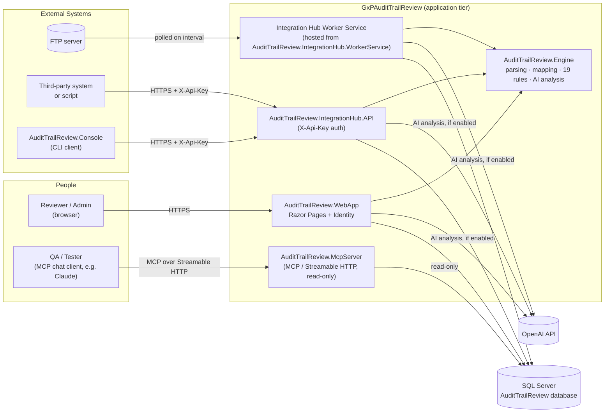

# 0000. High-Level Architecture Overview

Status: Living document (updated as the architecture changes; not itself a single decision)
Date: 2026-09-01

## Purpose
This is the entry point for understanding how GxPAuditTrailReview is put together, before diving into the individual decisions recorded in this folder. It reflects the solution as of v0.6, with the v0.8 and v0.9 additions noted in the last bullets of *Key architectural facts*.

## Components

| Component | Project | Role |
|---|---|---|
| **Web application** | `AuditTrailReview.WebApp` | Razor Pages UI + ASP.NET Core Identity. The primary way users create systems, upload/preview scans, review findings, sign/reopen scans, configure the rule engine, administer users/roles, and view logs. |
| **Engine** | `AuditTrailReview.Engine` | Shared library: file parsing (CSV/XML/JSON), header-keyword mapping to a common audit-trail model, the 19-rule review engine, OpenAI-based AI analysis, and cross-cutting services (email, user activity logging, internal audit-trail logging). Referenced by the WebApp, the Worker Service, and the API. |
| **Model** | `AuditTrailReview.Model` | Shared domain types: scan, system, rule, engine settings, review status enums, etc. Referenced by every other project. |
| **Database** | `AuditTrailReview.Database` | EF Core `ApplicationDbContext` used by every component to reach the single shared SQL Server database. |
| **Integration Hub API** | `AuditTrailReview.IntegrationHub.API` | ASP.NET Core Web API. Exposes `POST /api/ScanProcessing/scan`, authenticated by an `X-Api-Key` header, for external/scripted submission. |
| **Integration Hub Worker Service** | Hosted from `AuditTrailReview.IntegrationHub.WorkerService` (project file `AuditTrailReview.IntegrationHub.WorkerService.csproj`) | Background service that polls a configured FTP location on an interval and ingests new files automatically. |
| **Console client** | `AuditTrailReview.Console` | Cross-platform CLI that posts a local file to the Integration Hub API. |
| **MCP server** | `AuditTrailReview.McpServer` | ASP.NET Core host exposing read-only scan/system query tools over the Model Context Protocol (MCP) to a chat client (e.g. Claude), for QA data exploration. Shares the same database as every other component; has no write path at all (see ADR-0010). |
| **Test projects** | `AuditTrailReview.UnitTest`, `AuditTrailReview.UISeleniumTest` | MSTest unit tests (currently covering Engine logic only) and Selenium UI tests. |
| **Docs** | `AuditTrailReview.Docs` | This documentation set. |

## Component diagram

## Key architectural facts

- **One shared database, three write paths, one read-only consumer.** The WebApp, the Integration Hub API, and the Worker Service all connect to the same `AuditTrailReview` SQL Server database via `AuditTrailReview.Database`'s `ApplicationDbContext`. A scan created through any path is immediately visible through every other (see ADR-0002). `AuditTrailReview.McpServer` (v0.9) is a fourth consumer of the same `ApplicationDbContext`, but never writes to it (see below).
- **One shared rule engine, reused everywhere, including the AI step.** All three ingestion paths call into `AuditTrailReview.Engine` for parsing, mapping, the 19-rule evaluation, and the AI-assisted analysis step (see ADR-0003, ADR-0006).
- **Two independent entry points for external/automated ingestion.** FTP polling (push-by-placing-a-file, pulled on a timer) and a synchronous HTTP API (push-by-request) are both live and are not layered on top of each other (see ADR-0005).
- **Authentication differs by entry point.** The WebApp uses cookie-based ASP.NET Core Identity sign-in with three roles (see ADR-0007). The API uses a static API key per caller (admin-generated and DB-stored, encrypted, as of 2026-11-05 -- see ADR-0005), with no per-caller identity beyond the key itself; it is rate limited (ADR-0005).
- **Deployment unit = one container per hostable component.** `AuditTrailReview.WebApp`, `AuditTrailReview.IntegrationHub.API`, `AuditTrailReview.IntegrationHub.WorkerService` (Worker Service), and `AuditTrailReview.McpServer` each ship a `Dockerfile` and can be deployed independently; the Console client does not (it's meant to run as a short-lived CLI invocation, not a long-running service). `McpServer`'s `Dockerfile` isn't wired into any `docker-compose*.yml` yet.
- **Schema is not code-first migrated.** Unlike a typical EF Core setup, the database schema is created and evolved via versioned raw SQL scripts checked into `AuditTrailReview.Database/Database schema/`, not `dotnet ef migrations` (see ADR-0004).
- **Large uploads go through a queue (v0.8).** A web upload above 10 MB, and every Integration Hub API upload, is stored in `dbo.ScanUploadJob` and scanned in the background (in the WebApp for 10 to 50 MB, by the Worker Service otherwise), always through the same `ScanProcessingService.ProcessFileAsync`. The API therefore never processes a file itself, and a Worker Service must run wherever the API runs (ADR-0008).
- **Evaluation flavors (v0.8).** SQL Server stays the supported database; `docker/docker-compose.sqlite.yml` and `docker/docker-compose.postgres.yml` run the WebApp (and, for PostgreSQL, the API and Worker Service) on SQLite or PostgreSQL for trying the product only (ADR-0009).
- **Read-only MCP server for QA data exploration (v0.9).** `AuditTrailReview.McpServer` exposes two tools (`list_systems`, `list_scans`) over the Model Context Protocol so a chat client can query scan/system data directly from the shared database. Every tool is `AsNoTracking`, and the project never calls `SaveChanges` -- there is no write path through this component at all. `/mcp` requires an API key (header name configurable via `McpAuth:HeaderName`; the key itself is generated/revoked from `AdminPanel -> Settings -> MCP` and stored encrypted in `dbo.McpApiKeyCredential`, a pool structurally separate from the Integration Hub API's own keys -- see ADR-0005's 2026-11-05 amendment), is rate limited per caller IP (`McpRateLimiting`), and the component exposes an unauthenticated `/health` probe (ADR-0010).

## Where to go next

- For *why* the solution is split into this many projects: ADR-0001.
- For the data-consistency implications of the shared database: ADR-0002.
- For how a file actually gets from upload to stored findings: ADR-0003.
- For the Integration Hub's two ingestion mechanisms and their trade-offs: ADR-0005.
- For the AI-analysis step and its current risks: ADR-0006.
- For the current state of role-based access control: ADR-0007.
- For large-upload queuing: ADR-0008. For the SQLite/PostgreSQL evaluation flavors: ADR-0009.
- For the read-only MCP server and why it's kept separate from the Integration Hub API: ADR-0010.
- For detailed, requirement-by-requirement behavior: `3 Functional & Configuration Specification.md` in `Validation Package/`.
