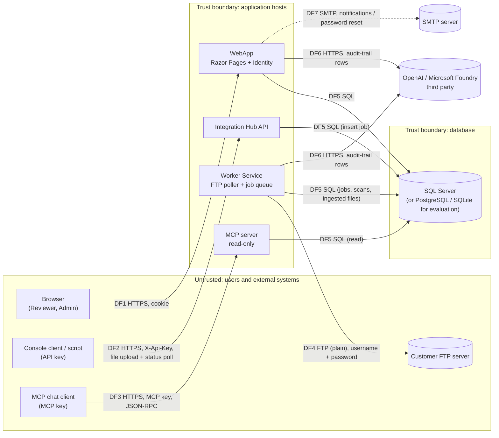

# Threat Model (STRIDE)

| Field | Value |
|---|---|
| Product | GxPAuditTrailReview (all components) |
| Baseline | v0.9 (in development), `master` @ `405a3a2` |
| Prepared | 2026-11-06 |
| Status | Draft, to be reviewed before the v1.0 release candidate |
| Method | STRIDE per element and data flow, based on a review of source code and configuration |
| Companions | [Path to v1.0 - Cybersecurity.md](../Product/Path%20to%20v1.0%20-%20Cybersecurity.md) (the to-do list, referred to below as **CS-n**), [ADR-0000](../ADR/0000-high-level-architecture.md) (architecture) |

## Purpose and scope

This document answers item CS-7 ("a short threat model"). It lists what can go wrong at each component and data flow, what already protects against it, and which open item tracks the gap. It does not repeat the fixes; those are in the Cybersecurity list. It is not a penetration test.

In scope: the WebApp, Integration Hub API, Worker Service (FTP and job queue), MCP server, the shared database, the Console client, the OpenAI/Foundry call, and the Docker deployment. Out of scope: the customer's own network, the FTP server itself, the reverse proxy product, and the source systems that produce the audit-trail exports.

Assumptions:
- Each component runs behind a TLS-terminating reverse proxy in production (required by CS-5 and CS-13, not yet enforced).
- The database server is reachable only from the application hosts.
- Admins and Super Users are trusted; Reviewers and Viewers are trusted only for their role.

## Assets

| Asset | Why it matters |
|---|---|
| Audit-trail files and scan results | Regulated GxP data from customer systems: user names, record IDs, old and new values. Confidentiality and integrity. |
| Review decisions, electronic signatures, reopen records | Part 11 / Annex 11 evidence. Integrity and non-repudiation. |
| User activity log, application log, internal audit trail | Evidence for investigations. Integrity. |
| User accounts, roles, password hashes | Control who can sign off. |
| Master encryption key (`Security:EncryptionKey`) | Decrypts the OpenAI key and every API and MCP key. |
| API keys, MCP keys, OpenAI key, SMTP and FTP passwords, DB connection string | Each one gives access to a component or a third party. |
| Rule configuration (`Rules`, `EngineSettings`) | Changing it changes what every future scan reports. |

## Data flow diagram

| Flow | From → to | Data | Authentication |
|---|---|---|---|
| DF1 | Browser → WebApp | Pages, uploads (up to the outer request limit), review decisions, signatures, admin settings | Identity cookie, password re-entry for close/sign and reopen |
| DF2 | Console/script → API | Audit-trail file, `systemId`; then `GET scan/{jobId}` | Static API key from `dbo.ApiKeyCredential` |
| DF3 | Chat client → MCP server | `list_systems`, `list_scans` calls and results | Static MCP key from `dbo.McpApiKeyCredential` |
| DF4 | Worker → FTP server | Listing, file download, move to processed/failed folder | FTP username and password from config |
| DF5 | Each component → DB | Everything | One SQL login shared by all components (CS-19) |
| DF6 | WebApp/Worker → OpenAI | Up to 300 result rows, or a sample plus a summary | OpenAI key (stored encrypted) |
| DF7 | WebApp → SMTP | Notification and password-reset e-mails | SMTP password from config |

## STRIDE analysis

Each row is one threat. **Mitigation** is what exists today (verified in the source on the date above). **Gap / tracked in** points to the open item; "accepted" means no change is planned for v1.0.

### Browser ↔ WebApp (DF1)

| STRIDE | Threat | Mitigation today | Gap / tracked in |
|---|---|---|---|
| S | Log in with the seeded admin password published in `appsettings.json` | None if the installer didn't override it | CS-3 |
| S | Password guessing or spraying against `/Identity/Account/Login` | Per-account lockout after N failures, configurable password policy | No per-IP rate limit: CS-9. No breached-password check: CS-18 |
| S | Use a colleague's unlocked, still signed-in session to sign off a scan | Password re-entry is required to close/sign and reopen (`Details.cshtml.cs`, `ReauthenticateAsync`) | 14-day sliding cookie, "Remember me": CS-4 |
| S | Session cookie stolen in transit or by script | `Secure`, `HttpOnly`, HSTS and HTTPS redirection outside Development | Forged `X-Forwarded-Proto` on an unproxied request: CS-1, CS-5 |
| T | Cross-site request forgery on review or admin forms | Antiforgery tokens on all forms, `SameSite` cookie | Accepted |
| T | Cross-site scripting through file names, header values or comments | Razor HTML-encodes output, the notification bell escapes its strings, CSP | `script-src 'unsafe-inline'` weakens CSP: CS-8 |
| T | Clickjacking a sign-off button | `X-Frame-Options: DENY`, `frame-ancestors 'none'` | Accepted |
| T | Malicious upload: XXE, entity expansion, deep JSON, CSV/Excel formula injection | `XDocument.Parse` prohibits DTDs, `JsonDocument` default max depth, Excel cells written as text | Defaults not asserted in code or tests: CS-15 |
| R | User denies having signed or reopened a scan | Signature record with user and time (UTC); re-authentication written to the login log | Signature meaning: main list item 1. Records can be edited by anyone with DB access, no hash chain: main list item 2 |
| R | Forged client IP in the login log | The login log records `RemoteIpAddress` only; forwarded headers are honoured just from the configured `ForwardedHeaders:KnownProxies`/`KnownNetworks` | Mitigated (CS-1) |
| I | Reviewer or Viewer reads pages meant for Admins | Every page requires sign-in by default (`AuthorizeFolder("/")`), role checks on AdminPanel and Logs | Accepted |
| I | Error page leaks stack traces or configuration | Custom error and status-code pages outside Development | Accepted |
| I | User enumeration through login or password-reset responses | Identity's default generic messages | Accepted |
| D | Lock out any user, including Admins, by entering 5 wrong passwords | Last active Admin is exempt | Permanent deactivation: CS-2 |
| D | Large or many uploads exhaust WebApp memory | Outer request size limit, uploads over 10 MB go to the `ScanUploadJob` queue, 10-50 MB tier in memory | Accepted (bounded by the outer limit) |
| E | Reviewer changes rules, users or settings | Role-based authorization on AdminPanel, three-role model (ADR-0007) | Accepted |
| E | Self-registration creates an account | Register and unused Identity pages disabled (TC-791) | Follow-ups: main list item 6 |

### Console client / script ↔ Integration Hub API (DF2)

| STRIDE | Threat | Mitigation today | Gap / tracked in |
|---|---|---|---|
| S | Call the API with a guessed or leaked key | Random keys, constant-time compare (`ApiKeyCredentialValidator`), revocable in AdminPanel, per-IP and per-key rate limit | No expiry, scopes or last-used: main list item 10. Keys stored decryptable, not hashed: CS-13 |
| S | API key leaked from the Console's `appsettings.json` on a workstation | Placeholder `CHANGE_ME_API_KEY` is rejected by the client | Accepted, document key handling for integrators (CS-20) |
| T | Key or file altered in transit | HTTPS outside Development | TLS termination not enforced in Docker: CS-5 |
| T | Upload a file into the wrong system | `systemId` validated (400 on unknown system) | Any key can upload to any system; key-to-system scoping: main list item 10 |
| R | Nobody can say which integrator uploaded a scan | Job row has `Source=Api` | No key identity stored on the job or scan: CS-16, main list item 10 |
| I | Any valid key reads the status of any job by incrementing `jobId` (sequential IDs), including WebApp uploads' file names and error messages | Requires a valid key | CS-16 (TM-1) |
| D | Flood the API or queue large files so real jobs wait behind them | Rate limiter, `RequestSizeLimit`, per-file size check, sequential Worker processing | Behind a proxy all callers share one bucket: CS-13 |
| E | API used to read or change data beyond uploads | The API exposes only upload and job status | Accepted |

### Chat client ↔ MCP server (DF3)

| STRIDE | Threat | Mitigation today | Gap / tracked in |
|---|---|---|---|
| S | Use the MCP endpoint with a guessed or leaked key | `McpApiKeyMiddleware`, keys separate from API keys, revocable without restart, rate limit runs before the key check | Same as the API: CS-13, main list item 10 |
| T | Prompt injection in audit-trail data (for example a file name like "ignore previous instructions...") steers the chat client | The server is read-only by construction (no `SaveChanges`), so the worst result is a misleading answer, not a changed record | Accepted. Document that MCP output is for exploration, not GxP evidence |
| R | No record of who queried what | None: a static key has no user identity, and the server has no Serilog/`ApplicationLog` sink (ADR-0010) | CS-17 (TM-2), CS-14 |
| I | Scan and system metadata leaves the organisation through the chat client's LLM provider | Tools return metadata only (IDs, names, dates, file names), not audit-trail rows | The chat client's provider and retention are the customer's decision; document it alongside CS-12 |
| I | Key sent over plain HTTP (compose port 8082, dev endpoint) | ADR-0010 says TLS in front is required | No HTTPS redirection or HSTS in the MCP host: CS-13 |
| D | Expensive queries exhaust the DB | `list_scans` capped at 200 rows, `AsNoTracking`, rate limit | Accepted |
| E | A tool call writes to the database | No write path exists | DB login is not read-only: CS-19 |

### Worker Service ↔ FTP server (DF4) and job queue

| STRIDE | Threat | Mitigation today | Gap / tracked in |
|---|---|---|---|
| S | A spoofed FTP server (DNS or network) feeds forged audit-trail files | None: plain FTP, no server authentication | FTPS/SFTP: main list item 3 |
| S | Anyone with write access to the FTP folder submits files as that system | One Worker instance ingests for exactly one `Ftp:SystemId` | Folder permissions are the customer's control; document in the Installation Manual (CS-20) |
| T | File modified in transit, or replaced on the server between listing and download | Upload-stability check (size and MDTM) before processing | No integrity check of the file: main list item 3. Original file is stored with the scan, so the reviewed content is what was ingested |
| T | The same file ingested twice, or a crash leaves half-processed state | Claim-before-work in `dbo.IngestedFile`, `RecoverStuckClaimsAsync`, one transaction per scan | Accepted |
| R | Which file produced which scan | File name and system recorded on the scan and in `IngestedFile` | Accepted |
| I | FTP password and file content sniffed on the network | None | Main list item 3 |
| D | A huge or malformed file blocks the queue | Size limit, retries capped at `MaxRetryAttempts` then `Failed`, `FileContent` streamed not tracked | Sequential processing means one large file delays all others; accepted, documented in CLAUDE.md and ADR-0008 |
| E | Parser bug in an uploaded file gives code execution | Managed code, no deserialisation of types, safe XML defaults, non-root container user | CS-15 |

### Components ↔ database (DF5)

| STRIDE | Threat | Mitigation today | Gap / tracked in |
|---|---|---|---|
| S | Use the connection string from any component's config to log in | Config files on application hosts only | Plain-text secrets: CS-6 |
| T | Edit scan results, signatures or logs directly in SQL | None in the application | Hash chain: main list item 2. No `UPDATE`/`DELETE` on log tables for the app login: CS-19 |
| T | SQL injection | EF Core everywhere; raw SQL in `ScanFileReader` and `ScanUploadJobProcessor` is parameterised | Accepted |
| R | Direct DB changes leave no trace in the application | None | DB-level auditing is the customer's control; mention in CS-20 checklist |
| I | Database port reachable from the internet (Docker PostgreSQL `5432:5432`) | Password | CS-5 |
| I | A DB backup or dump reveals keys | API, MCP and OpenAI keys are encrypted with the master key | Master key in plain config next to the connection string: CS-6. Hashing API/MCP keys: CS-13 |
| D | One component's load (a 700 MB blob) starves the others | Streamed blob reads, set-based status updates | Accepted |
| E | A compromised MCP server or API writes anywhere | None: one login with full rights for all components | CS-19 |

### WebApp / Worker → OpenAI (DF6)

| STRIDE | Threat | Mitigation today | Gap / tracked in |
|---|---|---|---|
| S | Traffic sent to a lookalike endpoint | HTTPS to a configured endpoint (`OpenAIService.ResolveEndpoint`) | Endpoint is an Admin setting; changes should be logged: CS-14 |
| T | A crafted audit-trail value (prompt injection) makes the AI summary say something false | AI output is advisory, shown separately from rule results, and never fails or changes the scan | Accepted. State in the User Manual that AI output is not part of the review record |
| I | Regulated data (user names, values) sent to a third party, possibly outside the EU, before anyone approved it | Can be disabled; Foundry endpoint allows regional hosting | On by default, no pseudonymisation: CS-12 |
| I | OpenAI key leaked | Stored encrypted with the master key | CS-6 |
| D | Provider outage or quota exhausted | AI runs after the scan is saved, on a background queue, and never fails the scan | Accepted |

### WebApp → SMTP (DF7)

| STRIDE | Threat | Mitigation today | Gap / tracked in |
|---|---|---|---|
| S / I | Password-reset link intercepted or the SMTP password leaked | Reset tokens are single-use and time-limited (Identity) | SMTP password in plain config: CS-6. Use STARTTLS; add to the CS-20 checklist |

### Cross-cutting: secrets, deployment and supply chain

| STRIDE | Threat | Mitigation today | Gap / tracked in |
|---|---|---|---|
| I / E | Master key left at the placeholder, or copied from one environment to another | Placeholder visible in config | No fail-fast, no rotation: CS-6 |
| S | Cookies invalidated or forgeable because Data Protection keys are lost or unprotected | Default key ring | CS-10 |
| T | Compromised NuGet package, front-end library or base image | No known vulnerable packages (scan of 2026-11-05), non-root containers | No checks in CI: CS-11 |
| R | Security events go unnoticed | Events are logged to `UserActivityLog` and `ApplicationLog` | No alerting: CS-14 |

## Findings from this threat model

These were not on the Cybersecurity list when this review started and have been added to it (2026-11-06).

| # | Finding | Tracked in |
|---|---|---|
| TM-1 | `GET api/ScanProcessing/scan/{jobId}` returns any job to any valid API key. Job IDs are sequential integers, so one integrator can list file names, system IDs and error messages of every other integrator's uploads and of large WebApp uploads. | CS-16 (P2) |
| TM-2 | The MCP server logs to the console only (ADR-0010), so MCP access isn't in `dbo.ApplicationLog` with the other components, and nobody can say which key queried what. | CS-17 (P2) |

## Keeping this document current

Review this threat model when any of the following changes, and at least once per release:
- a new component, endpoint, MCP tool or external service (for example a new AI provider);
- a change to authentication, roles, the key model or the secrets set-up;
- a new ingestion path or file format;
- the deployment model (for example Kubernetes, or a second WebApp instance).

When an item in the Cybersecurity list is closed, update the matching "Gap / tracked in" cell here. The Risk Assessment's security section (CS-7) should link to this document.
